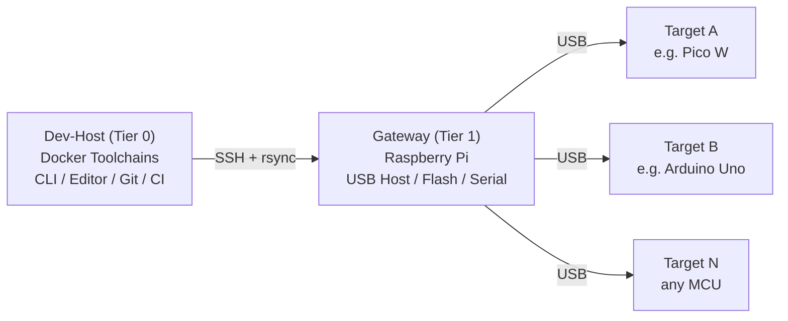
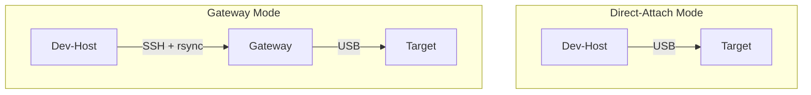
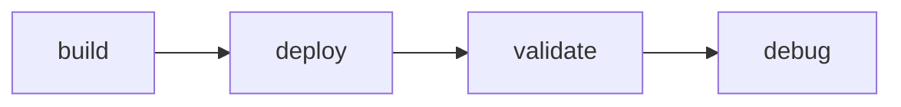
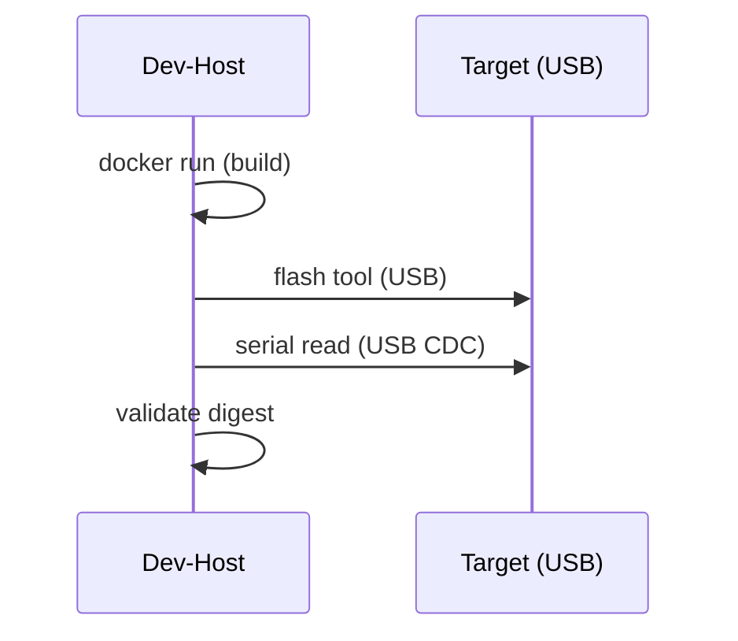
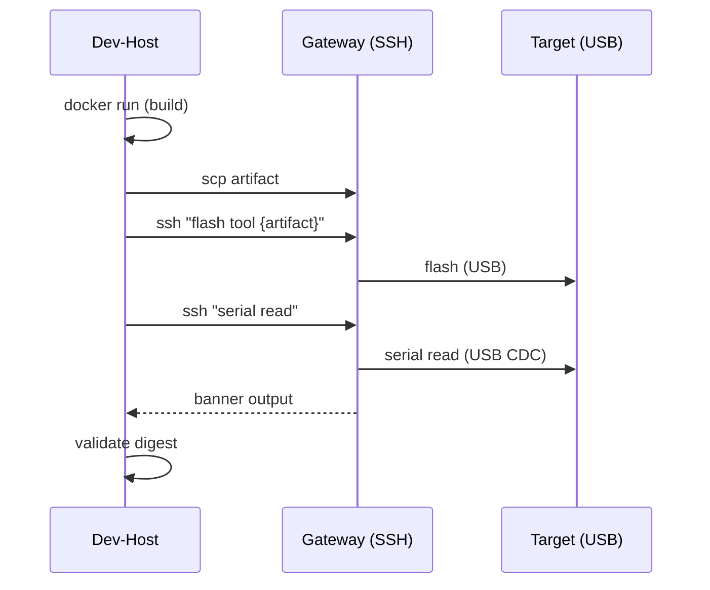
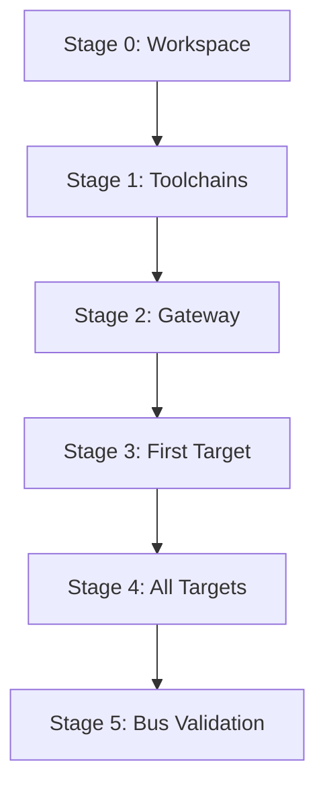
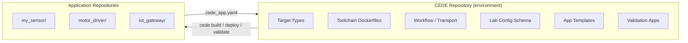

# CEDE Design Specification

**Containerized Embedded Development Environment -- Redesign**

> This document is the authoritative specification for CEDE v2. Every
> section uses a stable identifier (DS-1 through DS-18) so that other
> documents, issues, and conversations can reference it precisely --
> e.g. "see DS-5.2" or "per DESIGN_SPECIFICATION Section 9."

### Status and Operating Guide

This specification supersedes the v1 design document at the repository
root (`DESIGN.md`). When the v1 doc and this spec disagree, this spec
wins.

The CEDE documentation set has three layers and they should not drift:

| Document | Role | Audience |
|----------|------|----------|
| **`docs/DESIGN_SPECIFICATION.md`** (this doc) | Authoritative architecture, contracts, invariants (DS-1..DS-18), plus **Appendices A–E** (glossary, container bootstrap, boot images, toolchains, boot media). | Designers, reviewers, implementers |
| **`docs/USER_GUIDE.md`** | Day-to-day usage: scaffold, build, deploy, validate, debug, Make quick reference. | Users of the system |
| **`docs/DEV_OP.md`** | Developer and lab operations: **current state**, **roadmap**, and **full hardware validation** checklist (replaces former `ROADMAP.md` + `HARDWARE_VALIDATION.md`). | Integrators, release runners, bench operators |
| **`README.md`** (repo root) | One-screen entry, quick start, link hub. | Everyone first visit |
| **`lab/docs/`**, **`lab/pi/docs/`** | Pi bring-up, wiring, staged bootstrap next to scripts (not folded into `docs/`). | Lab operators |

Operational signals, bug findings, and tactical procedures belong in the
operating docs. Once a finding stabilizes into a rule that should always
be true (an invariant, contract, or constraint), it is promoted into
this specification.

---

## DS-1: Purpose and Scope

### DS-1.1 What CEDE Is

CEDE (**C**ontainerized **E**mbedded **D**evelopment **E**nvironment) is a
lightweight, container-driven system for building, deploying, validating,
and debugging firmware on microcontroller targets. It provides:

- **Reproducible builds** via Docker-packaged toolchains -- one image per
  MCU toolchain family, version-pinned, multi-arch.
- **A unified workflow** (`build` / `deploy` / `validate` / `debug`) that
  works identically whether the target MCU is plugged into the developer's
  own USB port or attached to a remote Raspberry Pi gateway.
- **A generic Target Type abstraction** so that adding a new MCU family
  (ESP32, STM32, nRF, ...) requires only a YAML manifest and a
  Dockerfile -- not structural changes to CEDE itself.
- **A clear separation between environment and applications.** CEDE
  manages toolchains, workflow, and transport. Firmware applications --
  including the validation firmware used to test the lab itself -- are
  independent projects that consume CEDE through a lightweight manifest
  (`cede_app.yaml`). See DS-18.

### DS-1.2 What CEDE Is Not

- CEDE is **not** a board-farm scheduler or resource-locking system.
  It targets single-developer, single-gateway workflows.
- CEDE does **not** run daemons or agents on the gateway. All remote
  operations use SSH sessions and standard Unix tools.
- CEDE does **not** provide an RTOS, HAL, or firmware framework. It
  manages the *environment* around firmware development, not the firmware
  itself.

### DS-1.3 Scope of This Document

This specification covers architecture, terminology, workflow, transport,
configuration, and extensibility. It does **not** prescribe specific
sensor drivers, application logic, dashboards, or OTA update mechanisms --
those are downstream concerns that build on the contracts defined here.

---

## DS-2: Terminology

Canonical definitions for every term used in this specification. When a
term appears in other CEDE documents, it carries the meaning defined here.

For a **structured reader glossary** (expanded prose, embedded concepts,
and links to DS sections), see **Appendix A** at the end of this document.
If a phrase in the appendix ever disagrees with this table, **DS-2 wins**.

| Term | Definition |
|------|------------|
| **CEDE** | Containerized Embedded Development Environment. The system described by this specification. |
| **Dev-Host** | The developer's primary machine -- workstation, laptop, NUC, VM, or CI runner. Runs Docker, builds firmware, drives the gateway over SSH. Tier 0. |
| **Gateway** | A single-board computer (Raspberry Pi is the reference implementation) that is persistently connected to MCU targets via USB. Bridges the Dev-Host and the targets. Tier 1. |
| **Target** | A physical microcontroller board attached via USB to either the Dev-Host (Direct-Attach) or the Gateway. Tier 2. |
| **Target Type** | A named configuration bundle that fully describes how to build, flash, validate, and debug a family of MCUs. Defined in a YAML manifest. Examples: `pico`, `uno`, `esp32`. See DS-5. |
| **Toolchain Image** | A Docker image containing the compiler, SDK, flash utilities, and build tools for one Target Type. See DS-6. |
| **Artifact** | The output of a firmware build -- a flashable binary (`.uf2`, `.hex`, `.bin`, `.elf`) plus an optional build-identity sidecar. |
| **Flash Method** | The tool and procedure used to write an Artifact to a Target (e.g. `picotool load`, `avrdude`, `esptool.py`, `openocd`). Defined per Target Type. |
| **Transport** | The mechanism used to move Artifacts and commands between tiers: SSH + rsync (Dev-Host to Gateway), USB (Gateway/Dev-Host to Target). See DS-8. |
| **Direct-Attach Mode** | Deployment mode where the Target is plugged into the Dev-Host's own USB port. No gateway is involved. See DS-12.1. |
| **Gateway Mode** | Deployment mode where the Target is plugged into the Gateway's USB port. The Dev-Host reaches it via SSH. See DS-12.2. |
| **Workspace** | A checked-out copy of the CEDE repository on the Dev-Host. The single source of truth for toolchain definitions, lab configuration, and tests. |
| **Lab Manifest** | The file `lab.yaml` -- the single source of truth for lab topology: gateway address, target inventory, serial device rules, bus wiring. See DS-10. |
| **Application Manifest** | The file `cede_app.yaml` within an application project -- declares the application to CEDE: target type, build entry, artifact pattern, banner prefix. See DS-11. |
| **Build Identity** | A short token (typically a 12-character git SHA) embedded in firmware at build time and printed on the serial banner at runtime. Used for attestation. See DS-9. |
| **Attestation** | The act of verifying that the firmware running on a Target matches a specific build by comparing the serial banner's `digest=` field against the expected Build Identity. |
| **Serial Banner** | The startup message printed by CEDE-aware firmware over USB CDC serial. Format: `CEDE <app_id> [<target>] ok digest=<id>`. Machine-readable. |
| **Staged Bootstrap** | The ordered bring-up sequence for a new lab, where each stage has explicit pass/fail gates. See DS-14. |
| **Smoke Test** | A quick sanity check that toolchains are functional -- typically runs version commands inside Docker containers. |
| **Flash-Test** | A combined flash + validate cycle: upload firmware, then verify the serial banner and Build Identity. |
| **Validation Application** | A firmware application whose primary purpose is to validate the CEDE lab environment -- gateway connectivity, flash path, serial data plane, I2C bus. Examples: `hello_lab`, `i2c_hello`. Follows the same `cede_app.yaml` contract as any user application. See DS-18.3. |
| **User Application** | A firmware or software project developed by the user for their own purposes. Consumes CEDE's workflow via `cede_app.yaml`. Lives in its own repository, independent of the CEDE Workspace. See DS-18.4. |
| **Gateway Application** | A software application (typically Python) that runs on the Gateway itself rather than on an MCU target. Deployed via rsync + SSH. See DS-18.2. |
| **Application Repository** | A standalone git repository (or directory) containing firmware source, build files, and optionally a `cede_app.yaml`. Independent of the CEDE Workspace. |
| **Application Category** | One of three classifications: `validation`, `user`, or `gateway`. Declared in `cede_app.yaml`. See DS-11.5 and DS-18.2. |

---

## DS-3: Architecture Overview

### DS-3.1 Three-Tier Model

CEDE organizes hardware into three tiers. Each tier has a single,
well-defined role. Communication between tiers uses the simplest
reliable transport available.



### DS-3.2 Deployment Modes

CEDE supports two deployment modes. Both execute the same workflow steps
(DS-7); only the transport layer differs.



- **Direct-Attach** (DS-12.1): The Target is on the Dev-Host's own USB
  bus. Build, flash, validate, and debug all happen locally. No gateway
  required.
- **Gateway** (DS-12.2): The Target is on the Gateway's USB bus. The
  Dev-Host builds the Artifact, transfers it to the Gateway via
  SSH + rsync, then invokes flash and validation commands on the Gateway
  over SSH.

### DS-3.3 Single Gateway

This specification defines support for one Gateway. Multi-gateway
topologies are noted as a future extension (DS-17) but are explicitly
out of scope for the initial implementation.

---

## DS-4: Roles and Responsibilities

### DS-4.1 Dev-Host (Tier 0)

| Responsibility | Detail |
|----------------|--------|
| Code editing | Any editor or IDE; VS Code Remote-SSH for gateway-attached work |
| Containerized builds | Run Toolchain Images via Docker to cross-compile firmware |
| CLI entry point | The `cede` CLI (or `make`) dispatches all workflow steps |
| Git source of truth | The Workspace holds all toolchain definitions, configs, and tests |
| CI parity | The same Docker images and commands run in CI as on a developer machine |
| Artifact production | Builds produce flashable binaries and Build Identity sidecars |

### DS-4.2 Gateway (Tier 1)

| Responsibility | Detail |
|----------------|--------|
| Persistent USB host | Always-on, always connected to Targets -- survives Dev-Host disconnects |
| SSH endpoint | Accepts SSH connections from the Dev-Host for flash, validate, and debug commands |
| Flash execution | Runs `picotool`, `avrdude`, `esptool.py`, or other flash tools locally on the USB bus |
| Serial access | Opens and reads USB CDC serial ports for validation and interactive debugging |
| Minimal footprint | No CEDE git clone, no Docker, no daemons -- only a sparse set of helper scripts synced from the Dev-Host |

### DS-4.3 Target (Tier 2)

| Responsibility | Detail |
|----------------|--------|
| Run firmware | Executes the flashed Artifact |
| Expose serial interface | Prints a Serial Banner on USB CDC for automated validation |
| Expose debug interface | Optionally provides SWD/JTAG or other debug access (Target-Type-dependent) |

---

## DS-5: Target Abstraction

### DS-5.1 Concept

A **Target Type** is a named, self-contained description of how CEDE
interacts with a family of microcontrollers. It decouples CEDE's
workflow engine from any specific MCU -- adding a new MCU means writing
a new Target Type manifest, not modifying CEDE's core.

### DS-5.2 Target Type Manifest

Each Target Type is defined by a YAML file that provides everything CEDE
needs to build, flash, validate, and debug firmware for that MCU family.

```yaml
# target-types/pico.yaml
target_type: pico
display_name: "Raspberry Pi Pico / Pico W (RP2040)"

toolchain:
  image: cede/pico-dev:local
  build_command: "cmake -B build -G Ninja && ninja -C build"
  artifact_pattern: "build/*.uf2"
  build_context: "/workspace"

flash:
  tool: picotool
  command: "picotool load -f -v -x {artifact}"
  pre_flash: "picotool reboot -uf"
  post_flash_delay_s: 3

serial:
  speed: 115200
  banner_pattern: "CEDE .+ ok digest={digest}"
  device_match:
    by_id_glob: "/dev/serial/by-id/usb-Raspberry_Pi_*"
    fallback_globs:
      - "/dev/ttyACM*"

debug:
  method: swd
  tool: openocd
  interface: "cmsis-dap"
  gdb_port: 3333
```

```yaml
# target-types/uno.yaml
target_type: uno
display_name: "Arduino Uno (ATmega328P)"

toolchain:
  image: cede/arduino-dev:local
  build_command: >-
    arduino-cli compile --fqbn arduino:avr:uno
    --output-dir build {sketch_dir}
  artifact_pattern: "build/*.hex"
  build_context: "/workspace"

flash:
  tool: avrdude
  command: >-
    avrdude -p atmega328p -c arduino
    -P {port} -b 115200
    -D -U flash:w:{artifact}:i
  post_flash_delay_s: 2

serial:
  speed: 115200
  banner_pattern: "CEDE .+ ok digest={digest}"
  device_match:
    by_id_glob: "/dev/serial/by-id/usb-Arduino_*"
    fallback_globs:
      - "/dev/ttyUSB*"
      - "/dev/ttyACM*"

debug:
  method: none
```

### DS-5.3 Target Type Contract

Every Target Type manifest MUST provide:

1. **`target_type`** -- unique identifier string (lowercase, no spaces).
2. **`toolchain.image`** -- Docker image tag for the Toolchain Image.
3. **`toolchain.build_command`** -- shell command to build firmware
   inside the container.
4. **`toolchain.artifact_pattern`** -- glob matching the build output(s).
5. **`flash.tool`** -- name of the flash utility.
6. **`flash.command`** -- parameterized command template. Placeholders:
   `{artifact}` (path to binary), `{port}` (serial device path).
7. **`serial.speed`** -- baud rate for USB CDC serial.
8. **`serial.banner_pattern`** -- regex to match the Serial Banner.
   `{digest}` is replaced with the expected Build Identity.
9. **`serial.device_match`** -- rules for discovering the target's serial
   device (stable `by_id_glob` preferred, with `fallback_globs`).

Optional fields: `flash.pre_flash`, `flash.post_flash_delay_s`,
`debug.*`, `toolchain.build_context`.

### DS-5.4 Initial Target Types

CEDE ships with two Target Types:

| Target Type | MCU | Voltage | Toolchain Image | Flash Tool | Artifact |
|-------------|-----|---------|-----------------|------------|----------|
| `pico` | RP2040 (Pico / Pico W) | 3.3 V | `cede/pico-dev` | `picotool` | `.uf2` |
| `uno` | ATmega328P (Arduino Uno) | 5 V | `cede/arduino-dev` | `avrdude` | `.hex` |

### DS-5.5 Adding a New Target Type

To add support for a new MCU family (e.g. ESP32):

1. Write `target-types/esp32.yaml` following the contract in DS-5.3.
2. Create `docker/esp32-dev/Dockerfile` with the required toolchain
   (see DS-6).
3. Register the flash tool in the Gateway's `bootstrap.sh` (if it is not
   already installed).
4. Write a Validation Application under `validation-apps/` with a Serial
   Banner (see DS-9 and DS-18.3). This serves as both an environment
   validation tool and a reference implementation for application
   developers.

No changes to CEDE's core workflow engine are required.

---

## DS-6: Toolchain Containers

### DS-6.1 Principles

- **One image per toolchain family.** The `pico-dev` image handles all
  RP2040 variants; `arduino-dev` handles all AVR boards via Arduino CLI.
  A future `esp-dev` would handle all Espressif chips.
- **Version-pinned.** Compiler versions, SDK versions, and package
  versions are locked in a `TOOLCHAIN_VERSIONS` file and baked into the
  Docker image. No floating tags.
- **Multi-arch.** Images are built for `linux/amd64` and `linux/arm64`
  so they run natively on both Intel Dev-Hosts and ARM64 CI runners.
  QEMU binfmt is used for cross-arch builds when needed.
- **Hermetic builds.** The container receives the source tree as a
  volume mount at `/workspace`. All build outputs go to a well-known
  subdirectory (`build/`). No host toolchain leakage.
- **No runtime on the Gateway.** Docker is a Dev-Host and CI concern.
  The Gateway runs only the flash and serial tools installed via its
  bootstrap script.

### DS-6.2 Image Inventory

| Image Tag | Base | Key Contents |
|-----------|------|--------------|
| `cede/pico-dev:local` | `debian:bookworm-slim` | ARM GCC, Pico SDK, CMake, Ninja, picotool |
| `cede/arduino-dev:local` | `debian:bookworm-slim` | avr-gcc, avr-libc, avrdude, arduino-cli, `arduino:avr` core |
| `cede/orchestration:local` | `python:3.12-slim-bookworm` | pyserial, pytest, pyyaml, jsonschema |

### DS-6.3 Build Invocation

A Toolchain Image is invoked by the workflow engine (DS-7) as follows:

```
docker run --rm \
  -v ${WORKSPACE}:/workspace \
  -w /workspace/${APP_DIR} \
  -e CEDE_IMAGE_ID=${BUILD_IDENTITY} \
  ${TOOLCHAIN_IMAGE} \
  sh -c "${BUILD_COMMAND}"
```

The contract:

- The container MUST produce at least one file matching
  `artifact_pattern` under the build output directory.
- If `CEDE_IMAGE_ID` is set, the build SHOULD embed it in the firmware
  binary (see DS-9).

### DS-6.4 Smoke Tests

Each Toolchain Image includes a smoke-test entrypoint that verifies the
toolchain is functional:

```
docker run --rm cede/pico-dev:local arm-none-eabi-gcc --version
docker run --rm cede/arduino-dev:local avrdude -?
```

These run as part of the Staged Bootstrap (DS-14, Stage 1).

---

## DS-7: Unified Workflow

### DS-7.1 Lifecycle

Every interaction with a Target follows four composable steps. Each step
can be run independently or chained together.



| Step | What Happens | Inputs | Outputs |
|------|-------------|--------|---------|
| **build** | Run the Toolchain Image to compile firmware | Source tree, Target Type, Build Identity | Artifact (binary + identity sidecar) |
| **deploy** | Transfer the Artifact to the Target's host and flash it | Artifact, deployment mode, serial port | Target running new firmware |
| **validate** | Read the Serial Banner and compare `digest=` against the expected Build Identity | Expected Build Identity, serial port | Pass / fail |
| **debug** | Open an interactive serial console, GDB session, or log capture | Serial port (or debug probe) | Developer interaction |

### DS-7.2 CLI Interface

The `cede` CLI (or equivalent Make targets) provides a consistent
interface regardless of Target Type or deployment mode:

```
cede build   --target pico [--app-dir ./my_app] [--digest abc123]
cede deploy  --target pico [--mode gateway|direct] [--gateway pi@cede-pi.local]
cede validate --target pico [--digest abc123]
cede debug   --target pico [--method serial|gdb]

cede flash-test --target pico    # deploy + validate in one step
cede run --target pico           # build + deploy + validate
```

Arguments default to values from `lab.yaml` (DS-10) and
`cede_app.yaml` (DS-11) when present.

### DS-7.3 Workflow Invariants

1. The **same commands** work in Direct-Attach and Gateway modes. The
   deployment mode is resolved from `lab.yaml` or an explicit `--mode`
   flag -- the user does not need to learn different commands.
2. Each step is **idempotent**. Running `deploy` twice with the same
   Artifact produces the same result.
3. **Failure at any step halts the chain.** A failed `build` does not
   attempt `deploy`. A failed `deploy` does not attempt `validate`.
4. **Build Identity flows through the chain.** The `build` step generates
   the identity; `deploy` carries the sidecar; `validate` checks it.

---

## DS-8: Transport Layer

### DS-8.1 Dev-Host to Gateway

| Mechanism | Use |
|-----------|-----|
| `ssh` | Execute commands on the Gateway (flash, validate, serial read) |
| `rsync` | Sync helper scripts from the Workspace to the Gateway's sparse working directory |
| `scp` | Transfer a single Artifact binary to the Gateway |

There are no daemons, proxies, or persistent connections. Each
operation opens a fresh SSH session, runs a command, and exits.

The Gateway address and credentials are configured in `lab.yaml`
(DS-10). SSH key-based authentication is assumed; CEDE does not manage
passwords.

**Quoting invariant.** Any command vector that crosses the SSH boundary
MUST be shell-quoted before transmission. Naïve `" ".join(argv)` and
unquoted `$@` expansion are forbidden because they silently split
multi-word arguments (e.g. `--expect 'CEDE hello_lab rp2 ok'`) when
the remote shell re-parses them.

| Layer | Required quoting primitive |
|-------|----------------------------|
| Python (`SSHTransport.run_command` and equivalents) | `shlex.join(cmd)` |
| Shell helpers on the Dev-Host that hand `argv` to a remote shell | `printf '%q ' "$@"` (Bash) before assembling the remote command string |
| Remote command bodies executed under `bash -lc` / `sh -c` | The body is treated as one already-quoted string; do not re-expand `$@` inside the heredoc |

The `quote-probe` step in `make hw-smoke` (DS-14.2) exercises this
contract end-to-end on every refactor.

### DS-8.2 Dev-Host / Gateway to Target

| Mechanism | Use |
|-----------|-----|
| USB mass storage | Pico BOOTSEL mode: copy `.uf2` to the mounted `RPI-RP2` volume |
| USB tool protocol | `picotool`, `avrdude`, `esptool.py`, etc. -- each Flash Method uses the appropriate USB protocol |
| USB CDC serial | 115200 baud, line-based. Used for Serial Banner validation and interactive debugging |

### DS-8.3 Serial Device Discovery

Targets are identified by their USB serial device path. The resolution
order (defined per Target Type in DS-5.2) is:

1. **Stable path** -- `/dev/serial/by-id/usb-<Vendor>_*` (preferred;
   survives re-enumeration).
2. **Fallback globs** -- `/dev/ttyACM*`, `/dev/ttyUSB*` (used when
   `by-id` is not available).
3. **Explicit override** -- the user passes `--port /dev/ttyXXX`.

**Stability rules.** CEDE code, scripts, and `lab.yaml` MUST NOT
hard-code `/dev/ttyACM0` (or any other numbered ACM/USB path) as the
target identifier. The numeric suffix on `/dev/ttyACM*` and
`/dev/ttyUSB*` is unstable across:

- gateway reboots,
- USB hub re-enumeration,
- a flash cycle that puts the Pico through BOOTSEL → UF2 → CDC,
- and the order in which Pico and Uno are physically plugged in.

`/dev/serial/by-id/...` is the canonical handle for an attached target
because it is keyed off the device's USB descriptor (vendor, product,
serial). Resolvers that consult only `by-id` and surface
"target not present" instead of falling through to a wrong ACM number
are preferred. Fallback globs exist for hosts where `by-id` symlinks
are not generated, and should be paired with vendor/product matching
to avoid binding to the wrong device on a busy USB bus.

### DS-8.4 Gateway Sparse Tree

The Gateway does **not** hold a full CEDE git clone. The Dev-Host syncs
only the minimal set of helper scripts needed for flash and validation:

```
~/cede/              # on the Gateway
  Makefile           # subset of gateway-side targets
  scripts/           # flash, validate, resolve-port helpers
```

Firmware binaries are transferred on demand via `scp`. Build artifacts
are never cached on the Gateway across sessions.

---

## DS-9: Build Identity and Attestation

### DS-9.1 Purpose

Build Identity links a specific firmware build to a running Target. It
prevents stale-firmware confusion: after flashing, CEDE can prove the
Target is running *this exact build*, not an older binary left on disk
or a board that failed to reboot.

### DS-9.2 Identity Token

The Build Identity is a short, deterministic string:

- **Default:** 12-character git short SHA of the Workspace HEAD
  (`git rev-parse --short=12 HEAD`).
- **Override:** an explicit `CEDE_IMAGE_ID` environment variable,
  useful in CI where each run needs a unique token.

### DS-9.3 Embed at Build Time

During the `build` step, a header file is generated:

```c
// cede_build_id.h (generated -- do not edit)
#define CEDE_IMAGE_ID "a1b2c3d4e5f6"
```

Firmware source includes this header and prints the token in its Serial
Banner:

```c
printf("CEDE hello_lab rp2 ok digest=%s\n", CEDE_IMAGE_ID);
```

A `.digest` sidecar file is written alongside the Artifact, containing
the same token as plain text.

**Scaffold contract.** Templates produced by `cede new-app` (DS-18.5)
MUST be validation-ready out of the box:

- The build system in the template (CMake for Pico, Arduino CLI for
  Uno, etc.) MUST consume `CEDE_IMAGE_ID` from the environment and
  inject it into the firmware (e.g. `-DCEDE_IMAGE_ID="..."` for Pico,
  generated header for Uno).
- A scaffolded project that has *not* set `CEDE_IMAGE_ID` MUST still
  build, but its Build Identity SHALL be the literal token `unknown`,
  not a missing or empty value.
- The Validation Application reference projects under
  `validation-apps/` are the canonical examples of correct injection
  and SHOULD be kept in lockstep with the templates.

### DS-9.4 Validate at Runtime

The `validate` step:

1. Opens the Target's serial port.
2. Reads lines until a Serial Banner matching the Target Type's
   `banner_pattern` (DS-5.2) appears, or a timeout expires.
3. Extracts the `digest=` value from the banner.
4. Compares it against the expected Build Identity (from the sidecar or
   the CLI argument).
5. Reports **pass** (exact match) or **fail** (mismatch or timeout).

**Banner emission contract.** The `validate` step must succeed without
relying on a USB-CDC reset to re-trigger boot output. To make
validation reliable on hosts where opening the port does not toggle
DTR (or where the validator races startup), CEDE-aware firmware SHOULD
emit the Serial Banner on a recurring schedule (e.g. every 1 - 5 s)
or otherwise re-print it any time the bus appears idle. A one-shot
banner at boot is acceptable only if the flash and validate path is
known to capture it deterministically. Validation Applications
(DS-18.3) and scaffolded templates (DS-18.5) MUST follow the recurring
emission pattern.

### DS-9.5 Serial Banner Format

```
CEDE <application_id> [<target_type>] ok digest=<build_identity> [(<extra>)]
```

Examples:

```
CEDE hello_lab rp2 ok digest=a1b2c3d4e5f6 (i2c 0x42 @ GP0/1)
CEDE hello_lab ok digest=a1b2c3d4e5f6 (i2c target 0x43)
CEDE my_sensor pico ok digest=deadbeef1234
```

The banner is printed once on USB CDC serial at startup (and optionally
on reset). The `CEDE` prefix and `digest=` field are the machine-readable
contract; everything else is informational.

---

## DS-10: Lab Manifest (`lab.yaml`)

### DS-10.1 Purpose

`lab.yaml` is the single source of truth for a specific lab's physical
topology. It is machine-specific (gitignored) and copied from a
checked-in `lab.example.yaml` template.

### DS-10.2 Schema

The Lab Manifest is validated against a JSON Schema
(`lab.schema.json`) at workspace setup and in CI.

### DS-10.3 Structure

```yaml
schema_version: 2

gateway:
  ssh_host: cede-pi.local
  ssh_user: pi
  work_dir: "~/cede"

targets:
  pico:
    type: pico                    # references target-types/pico.yaml
    attach: gateway               # or "direct"
    serial:
      by_id_glob: "/dev/serial/by-id/usb-Raspberry_Pi_*"
      fallback_globs:
        - "/dev/ttyACM*"
  uno:
    type: uno
    attach: gateway
    serial:
      by_id_glob: "/dev/serial/by-id/usb-Arduino_*"
      fallback_globs:
        - "/dev/ttyUSB*"
        - "/dev/ttyACM*"

i2c_matrix:
  bus_hz: 100000
  pairs:
    - initiator: gateway
      target: pico
      status: enabled
      linux_bus: 1
      probe_address: 0x42
      validation:
        reg: 0
        expect_byte: 0xCE
    - initiator: gateway
      target: uno
      status: enabled
      linux_bus: 1
      probe_address: 0x43
      validation:
        reg: 0
        expect_byte: 0xCE
```

### DS-10.4 Key Sections

| Section | Purpose |
|---------|---------|
| `gateway` | SSH connection details for the single gateway |
| `targets` | Inventory of attached targets: type, attachment mode, serial discovery rules |
| `i2c_matrix` | Bus wiring and validation rules for inter-tier I2C (gateway as controller to each target) |

### DS-10.5 Overrides

CLI flags override `lab.yaml` values. For example,
`--gateway user@host` overrides `gateway.ssh_host` and
`gateway.ssh_user`. This allows one-off use without editing the manifest.

---

## DS-11: Application Manifest (`cede_app.yaml`)

### DS-11.1 Purpose

An Application Manifest declares a firmware project to CEDE. It lives
in the project's root directory and contains everything CEDE needs to
build, deploy, and validate that application -- without requiring any
central registration in `lab.yaml`.

### DS-11.2 Structure

```yaml
application_id: hello_lab
target: pico
category: validation              # validation | user | gateway
entrypoint: build/*.uf2
resources:
  usb_serial:
    banner_prefix: "CEDE hello_lab rp2 ok"
  i2c:
    address: 0x42
    register_map:
      0: 0xCE
```

A minimal User Application manifest:

```yaml
application_id: my_sensor
target: pico
category: user
entrypoint: build/*.uf2
resources:
  usb_serial:
    banner_prefix: "CEDE my_sensor pico ok"
```

### DS-11.3 Fields

| Field | Required | Description |
|-------|----------|-------------|
| `application_id` | Yes | Unique string identifying the application. Used in serial banners and log files. |
| `target` | Yes | Target Type identifier (must match a `target-types/*.yaml` file). |
| `category` | Yes | One of `validation`, `user`, or `gateway`. See DS-11.5. |
| `entrypoint` | Yes | Glob pattern for the build artifact. |
| `resources.usb_serial.banner_prefix` | No | Expected prefix of the Serial Banner for validation. Defaults to `CEDE <application_id> ok`. |
| `resources.i2c.address` | No | 7-bit I2C responder address exposed by this firmware. |
| `resources.i2c.register_map` | No | Expected register values for I2C validation (register number to byte). |

### DS-11.4 Self-Describing Applications

Applications do **not** need to be registered in `lab.yaml`. The
`cede_app.yaml` file is the sole interface between an application project
and CEDE. This means:

- Applications can live in separate repositories.
- Multiple applications can target the same Target Type.
- CEDE discovers the manifest by looking for `cede_app.yaml` in the
  current directory (or the directory passed via `--app-dir`).

### DS-11.5 Application Categories

Every application declares a `category` in its manifest. The category
determines the application's role and how CEDE treats it during the
Staged Bootstrap (DS-14).

| Category | Purpose | Where It Lives | Deployed How |
|----------|---------|----------------|--------------|
| `validation` | Validate the CEDE lab environment: flash path, serial data plane, I2C bus. Run during Staged Bootstrap. | Ships alongside CEDE in `validation-apps/` (DS-18.3). | `cede build` + `cede deploy` (MCU firmware) |
| `user` | Developer firmware for their own purposes. Not part of CEDE's self-tests. | Independent Application Repository. | `cede build` + `cede deploy` (MCU firmware) |
| `gateway` | Software that runs on the Gateway itself (Python scripts, services). Target type is `pi`. | Independent Application Repository or `validation-apps/`. | `rsync` + `ssh` (no MCU flash) |

### DS-11.6 Application Separation Principle

CEDE's repository contains the **environment**: toolchain Dockerfiles,
workflow scripts, transport helpers, lab config schema, target-type
manifests, and application templates. It does **not** contain
application-specific business logic.

Application source code lives **outside** the CEDE tree in independent
projects. Even Validation Applications that ship alongside CEDE are
structured as standalone projects with their own `cede_app.yaml`, build
files, and source -- they could be extracted to separate repositories
without any changes to their internal structure.

The `cede_app.yaml` manifest is the **sole coupling point** between an
application and the CEDE environment. See DS-18 for the full
Application Architecture.

---

## DS-12: Deployment Modes

### DS-12.1 Direct-Attach Mode

The Target is plugged into the Dev-Host's own USB port. The full
workflow runs locally:



**When to use:** Solo development, quick iteration, CI runners with
USB-attached hardware, or any situation where a gateway is unavailable.

**Requirements:** Docker and the target's flash tool installed on the
Dev-Host. No network, no gateway.

### DS-12.2 Gateway Mode

The Target is plugged into the Gateway's USB port. The Dev-Host builds
locally, then uses SSH to transfer and flash:



**When to use:** The Target is physically distant from the Dev-Host,
the Dev-Host lacks USB ports (e.g. cloud CI), or the lab uses a
dedicated Pi wiring harness.

**Requirements:** SSH key-based access to the Gateway. Flash tools
installed on the Gateway (via `bootstrap.sh`). Docker is NOT required
on the Gateway.

### DS-12.3 Mode Resolution

The deployment mode is resolved in this order:

1. Explicit `--mode direct` or `--mode gateway` CLI flag.
2. Per-target `attach` field in `lab.yaml` (DS-10.3).
3. Default: `direct` (if no gateway is configured).

---

## DS-13: Debug Interface

### DS-13.1 Serial Console

The most common debug interface. CEDE provides:

- **Local console** (Direct-Attach): opens the serial port with
  `minicom`, `picocom`, or a built-in Python serial reader.
- **Remote console** (Gateway Mode): `ssh <gateway> picocom <port>`
  or equivalent.

Invocation:

```
cede debug --target pico --method serial
```

### DS-13.2 GDB (Target-Type-Dependent)

For targets that support SWD or JTAG debug (e.g. Pico via OpenOCD +
CMSIS-DAP):

```
cede debug --target pico --method gdb
```

This starts the debug server (e.g. `openocd`) and connects GDB. The
debug method and configuration are defined in the Target Type manifest
(DS-5.2, `debug.*` fields). Targets that lack debug probe support
(e.g. Arduino Uno) set `debug.method: none`.

### DS-13.3 Log Capture

CEDE can capture serial output to a timestamped log file:

```
cede debug --target pico --method serial --log ./logs/session.log
```

This is useful for long-running tests, sensor data collection, or
post-mortem analysis.

---

## DS-14: Staged Bootstrap

### DS-14.1 Purpose

A new lab (or a lab returning from a hardware change) is brought up in
stages. Each stage has explicit pass/fail gates. Stages are ordered so
that each one builds confidence in the layer below before adding the
next layer of complexity.

For a maintained **operational** map of which Makefile, pytest, and CLI commands validate each layer (Dev-Host, Docker toolchains, Pi as gateway, Pi as native **`hello_gateway`** target, Pico, Uno, tri-target bench, I2C matrix), see [USER_GUIDE.md §2.1](USER_GUIDE.md#21-validation-by-target-and-layer).

### DS-14.2 Stages



| Stage | Name | What It Proves | Gate |
|-------|------|----------------|------|
| 0 | **Workspace** | `lab.yaml` is valid, schema passes, Python deps installed | `cede validate --config` passes |
| 1 | **Toolchains** | Docker images build, smoke tests pass, Validation Application firmware compiles (DS-18.3) | `cede build --target <all>` produces artifacts for each Validation Application |
| 2 | **Gateway** | SSH to gateway works, gateway sees USB devices | `ssh <gateway> lsusb` succeeds |
| 3 | **First Target** | One target flashed with its Validation Application (`hello_lab`) and validated (serial banner + digest match) | `cede flash-test --target pico` passes |
| 4 | **All Targets** | Every target in `lab.yaml` flashed with its Validation Application and validated | `cede flash-test --all` passes |
| 5 | **Bus Validation** | I2C matrix (gateway as controller to each target) reads expected register values from Validation Application firmware | `cede validate --i2c` passes |

**Inner-loop smoke vs. release-grade validation.** The Staged Bootstrap
above is the release-grade gate. For the inner refactor loop CEDE also
defines a **Quick Hardware Smoke** (`make hw-smoke`) that compresses
stages 2 - 5 into one live-lab run: it **rebuilds** Validation Application
firmware in Docker, then checks the gateway, buses, and **flash + serial
attestation** on each MCU. Wall-clock is often several minutes when Docker
must compile from a cold cache; it is still the fast tripwire compared to a
full Part 3 sweep. The smoke is not a substitute for the deep plan; it catches
regressions between full sweeps.

| Aspect | `make hw-smoke` (inner loop) | [`docs/DEV_OP.md`](DEV_OP.md) **Part 3** (release) |
|--------|------------------------------|-----------------------------------------|
| Target runtime | often minutes (Docker `hello_lab` rebuild + two flashes) | tens of minutes |
| Coverage | fresh UF2/HEX per run, flash + validate each MCU, I2C register reads, SSH quoting probe | scaffold cycle, multi-app banners, negative tests, gateway-native, retries, cleanup |
| When to run | After every refactor / before merging | Before a release, or after a hardware change |
| Failure handling | Continue through all checks; fail summary at end | Stage-gated; stop at first failure |

**I2C bus speed.** With the reference 3.3 V ↔ 5 V level shifter,
Pi-as-controller I2C to both Pico and Uno targets is reliable at
100 kHz and unreliable at 400 kHz. Until a higher-quality shifter is
specified, `lab.yaml`'s `i2c_matrix.bus_hz` SHALL be set to `100000`
and the gateway SHALL be configured with
`dtparam=i2c_arm_baudrate=100000` (or equivalent). 400 kHz is
out of scope for the Hello Lab harness.

### DS-14.3 Failure Handling

If a stage fails, CEDE reports the failure clearly and does **not**
proceed to the next stage. The user fixes the issue and reruns the
failing stage.

**Bounded retry for hardware state-machine operations.** A narrow
exception applies to operations that are state machines on the USB or
flash bus, where one transient miss is normal even on healthy hardware.
The canonical example is the Pico flash path: BOOTSEL transition →
mass-storage mount → UF2 write → CDC re-enumeration. Pi USB hubs in
particular drop the occasional reset.

For these specific operations, CEDE may apply a small bounded
retry-with-backoff (default: 2 attempts, 5 s between). The retry is
allowed only when:

- The operation is a known hardware state-machine step (USB reset,
  flash, port re-enumeration), not a logical/test failure.
- The retry budget is small and bounded; exhausting it is a hard
  failure.
- Each attempt's output is preserved so an operator can compare runs.

Logical failures (digest mismatch, schema violation, banner regex
mismatch, I2C wrong byte, missing artifact) are never retried; they
fail fast.

---

## DS-15: Configuration and Extensibility

### DS-15.1 Adding a New Target Type

1. **Write the manifest:** Create `target-types/<name>.yaml` following
   the contract in DS-5.3.
2. **Build the Toolchain Image:** Create
   `docker/<name>-dev/Dockerfile` with the required compiler, SDK, and
   flash tools. Add it to `docker-compose.yml`.
3. **Install flash tools on the Gateway:** Add the necessary packages
   to `bootstrap.sh` (e.g. `esptool.py` for ESP32).
4. **Write a Validation Application:** Create a minimal firmware project
   under `validation-apps/` that prints a Serial Banner with `digest=`
   (DS-18.3). This serves as both an environment smoke test and a
   reference implementation for application developers.
5. **Register in `lab.yaml`:** Add the target to the `targets` section
   with its attachment mode and serial device rules.

No changes to CEDE's workflow engine, CLI, or transport layer are
required.

### DS-15.2 Adding a New Gateway (Future)

Multi-gateway support is out of scope for this specification (DS-3.3),
but the architecture is designed to accommodate it:

- `lab.yaml` can be extended with a `gateways` list (replacing the
  singular `gateway` key).
- Each target's `attach` field can reference a specific gateway by name.
- The transport layer (DS-8) already parameterizes the SSH host.

### DS-15.3 Adding a New Bus Protocol

The I2C matrix in `lab.yaml` (DS-10.3) can be extended with additional
bus types (SPI, UART, CAN) by adding new `bus_type` discriminators
to the `pairs` list. Validation commands are defined per bus type.

---

## DS-16: Design Principles

These are the non-negotiable rules that govern CEDE's architecture and
implementation. Every design decision should be traceable to one or more
of these principles.

### DS-16.1 Containers for Reproducibility

All build toolchains run inside Docker containers with version-pinned
dependencies. The same image that a developer uses on their laptop
runs in CI. "Works on my machine" is a solved problem.

### DS-16.2 SSH for Simplicity

All remote operations use SSH -- the most widely deployed, best-understood
remote execution mechanism in existence. No custom daemons, no RPC
frameworks, no message brokers, no proxy servers on the gateway. Every
remote operation is a single SSH command that can be run manually for
debugging.

### DS-16.3 Staged Complexity

Prove each layer before building the next. Toolchains before networking.
Networking before flashing. Flashing before bus validation. Optional
services (dashboards, telemetry, OTA) stay opt-in and never gate the
core workflow.

### DS-16.4 Test-Gated Progress

Every stage of the Staged Bootstrap (DS-14) has an explicit pass/fail
gate. Progress is earned by passing tests, not by assumption. When
hardware is absent, tests skip explicitly -- never silently.

### DS-16.5 Contracts Over Conventions

Serial banner formats, manifest schemas, artifact patterns, and device
discovery rules are documented contracts, not tribal knowledge. A new
team member (or a CI system) can integrate with CEDE by reading the
manifests.

### DS-16.6 No Daemons on the Gateway

The Gateway runs no CEDE-specific background services. It is a passive
SSH endpoint with flash tools installed. This makes Gateway setup trivial
(a bootstrap script), Gateway debugging simple (standard Linux tools),
and Gateway recovery straightforward (re-flash the SD card).

### DS-16.7 Generic Over Specific

CEDE's workflow engine operates on Target Types, not on hardcoded MCU
names. The `pico` and `uno` Target Types are configuration, not code.
Adding an `esp32` or `stm32` Target Type is a YAML + Dockerfile task.

---

## DS-17: Future Considerations

The following capabilities are explicitly out of scope for this
specification but are anticipated extensions. The architecture in DS-3
through DS-15 is designed to accommodate them without structural changes.

| Area | Description | How It Fits |
|------|-------------|-------------|
| **Multi-gateway** | Support N gateways, each with its own set of targets. | Extend `lab.yaml` with a `gateways` list; per-target `attach` references a named gateway. Transport layer (DS-8) is already parameterized. |
| **OTA updates** | Wireless firmware update for WiFi-capable targets (e.g. Pico W). | New Flash Method in the Target Type manifest; `flash.tool: ota`, `flash.command: <ota-upload-script>`. |
| **CI integration** | Run the full Staged Bootstrap in a CI pipeline with USB-attached hardware. | Direct-Attach mode (DS-12.1) already works on any machine with Docker and USB. CI-specific `lab.yaml` profiles can be added. |
| **Sensor framework** | Structured sensor driver integration with catalog, wiring docs, and validation tests. | Post-bootstrap concern. Sensor drivers build on the serial and I2C contracts from DS-8 and DS-10. |
| **Dashboard / telemetry** | Grafana, InfluxDB, or similar for real-time sensor visualization. | Optional gateway service. Does not affect the core workflow. |
| **MQTT** | Distributed messaging for multi-node sensor networks. | Optional gateway service. Does not affect the core workflow. |
| **Resource locking** | Prevent concurrent access to a target from multiple Dev-Hosts. | Could be implemented as a simple lockfile on the gateway, checked via SSH before flash operations. |

---

## DS-18: Application Architecture

### DS-18.1 Separation of Concerns

CEDE draws a hard boundary between the **environment** and the
**applications** that consume it.



**CEDE repository** contains:

- Toolchain Dockerfiles and `docker-compose.yml` (DS-6)
- Target Type manifests (DS-5)
- Workflow engine, CLI, and transport scripts (DS-7, DS-8)
- Lab config schema and example (DS-10)
- Gateway bootstrap helpers (DS-4.2)
- Application scaffolding templates (DS-18.5)
- Validation Applications (DS-18.3)
- CEDE self-tests (config schema validation, toolchain smoke)

**CEDE repository does NOT contain:**

- User application source code or build outputs
- Application-specific business logic
- Sensor drivers, dashboards, or data processing

### DS-18.2 Application Categories

All applications fall into one of three categories. The category is
declared in `cede_app.yaml` (DS-11.3) and determines the application's
relationship to the CEDE environment.

| Category | Target Tier | Purpose | Ships With CEDE? | Example |
|----------|-------------|---------|------------------|---------|
| `validation` | Tier 2 (MCU) | Validate the lab environment: prove flash, serial, and bus paths work. Run during Staged Bootstrap (DS-14). | Yes, in `validation-apps/` | `hello_lab` (pico), `hello_lab` (uno), `i2c_hello` |
| `user` | Tier 2 (MCU) | Developer firmware for their own purposes. | No -- independent repo | `my_sensor`, `motor_driver` |
| `gateway` | Tier 1 (Gateway) | Software running on the Gateway (Python scripts, services). | Optional -- may ship as demos | `ssd1306_eyes`, `data_logger` |

All three categories use the same `cede_app.yaml` contract (DS-11).
All MCU categories (`validation` and `user`) follow the same unified
workflow (DS-7). Gateway applications use `rsync` + `ssh` for deployment
instead of the MCU flash path.

### DS-18.3 Validation Applications

Validation Applications are firmware projects whose sole purpose is to
exercise the CEDE lab environment. They are the minimum viable firmware
needed to prove that the flash path, serial data plane, and bus wiring
work correctly.

**Characteristics:**

- Each Validation Application is a **self-contained project** with its
  own `cede_app.yaml`, build files, and source code.
- They ship alongside CEDE in a `validation-apps/` directory, organized
  by application name and target type.
- They could be extracted to separate repositories without any changes
  to their internal structure.
- They are the firmware run during Staged Bootstrap stages 1, 3, 4,
  and 5 (DS-14).
- They serve as **reference implementations** for application developers.

**Directory layout:**

```
validation-apps/
  hello_lab/
    pico/
      cede_app.yaml           # category: validation, target: pico
      CMakeLists.txt
      pico_sdk_import.cmake
      src/main.c              # serial banner + I2C responder + heartbeat LED
    uno/
      cede_app.yaml           # category: validation, target: uno
      hello_lab.ino
  i2c_hello/
    pico/
      cede_app.yaml
      CMakeLists.txt
      src/main.c
    uno/
      cede_app.yaml
      i2c_hello.ino
```

**What Validation Applications exercise:**

| Application | What It Validates |
|-------------|-------------------|
| `hello_lab` (pico) | Pico flash path (picotool), USB CDC serial banner, `digest=` attestation, I2C responder @ 0x42, heartbeat LED |
| `hello_lab` (uno) | Uno flash path (avrdude), USB CDC serial banner, `digest=` attestation, I2C responder @ 0x43, heartbeat LED |
| `i2c_hello` (pico + uno) | Multi-target I2C communication, register map validation, bus wiring between voltage domains |

### DS-18.4 User Applications

User Applications are firmware projects developed for the user's own
purposes. They live in independent repositories and consume CEDE's
workflow through the `cede_app.yaml` manifest.

**Characteristics:**

- A User Application builds **standalone** with a native toolchain
  (no CEDE dependency required for compilation).
- Optionally, it includes a `cede/` overlay directory with
  `Makefile.cede` and `gen_build_id.sh` for CEDE-integrated builds.
  The base `Makefile` uses `-include cede/Makefile.cede` so CEDE
  targets appear when the overlay is present but the project still
  builds without it.
- The `cede_app.yaml` is the **only coupling point** to CEDE.
- User Applications are never run during Staged Bootstrap.

**Project structure (with optional CEDE integration):**

```
my_sensor/                      # independent git repository
  CMakeLists.txt                # standalone Pico SDK project
  pico_sdk_import.cmake
  src/main.c
  Makefile                      # -include cede/Makefile.cede
  .gitignore
  README.md

  cede_app.yaml                 # CEDE manifest (category: user)
  cede/                         # CEDE integration overlay (optional)
    Makefile.cede               # docker-build, gateway-flash targets
    gen_build_id.sh             # digest generation for attestation
  tests/                        # hardware tests (optional)
    conftest.py
    test_my_sensor.py
```

### DS-18.5 Application Scaffolding

CEDE provides templates and a scaffolding command to create new
application projects:

```
cede new-app --target pico --name my_sensor --output ~/src/my_sensor
```

The generated project is immediately **standalone** -- it builds with
a native toolchain and has no CEDE dependency. To add CEDE integration:

```
cede new-app --target pico --name my_sensor --output ~/src/my_sensor --cede
```

This adds the `cede_app.yaml`, `cede/` overlay, and `tests/` directory.
The `category` field defaults to `user`.

Templates are stored in the CEDE repository under `templates/`:

```
templates/
  pico-app/                     # Pico SDK project scaffold
  uno-app/                      # Arduino sketch scaffold
  cede-overlay/                 # cede_app.yaml + Makefile.cede + tests
```

**Scaffold validation contract.** A freshly scaffolded application
must pass `cede build`, `cede deploy`, and `cede validate` against
real hardware **without manual edits**. Concretely:

1. The generated `cede_app.yaml` `entrypoint` MUST match the artifact
   the generated build system actually produces (e.g. for Uno with
   Arduino CLI, the artifact is named after the `.ino` file, not after
   the application).
2. The generated build system MUST inject `CEDE_IMAGE_ID` per DS-9.3.
3. The generated firmware MUST emit a recurring Serial Banner per
   DS-9.4.
4. The Validation Applications under `validation-apps/` are the
   reference for what "validation-ready" means; templates and
   validation apps SHOULD be kept in lockstep so a regression in one
   surfaces in the other.

A scaffold that requires the user to rename a file, edit
`CMakeLists.txt`, or add a banner loop in order to validate is a
defect against this section.

### DS-18.6 CEDE Repository Layout

The following layout makes the environment/application separation
visible at the file-system level:

```
cede/                               # CEDE environment repository
  target-types/                     # Target Type manifests (DS-5)
    pico.yaml
    uno.yaml
  docker/                           # Toolchain Dockerfiles (DS-6)
    pico-dev/Dockerfile
    arduino-dev/Dockerfile
    orchestration/Dockerfile
    docker-compose.yml
    TOOLCHAIN_VERSIONS
  scripts/                          # Workflow engine, deploy, validate
  gateway/                          # Gateway bootstrap + sparse-tree helpers
    bootstrap.sh
    scripts/
  config/                           # Lab configuration
    lab.example.yaml
    lab.schema.json
  templates/                        # Application scaffolding templates (DS-18.5)
    pico-app/
    uno-app/
    cede-overlay/
  validation-apps/                  # Validation Applications (DS-18.3)
    hello_lab/
      pico/                         # self-contained Pico project + cede_app.yaml
      uno/                          # self-contained Uno project + cede_app.yaml
    i2c_hello/
      pico/
      uno/
  tests/                            # CEDE self-tests (config schema, toolchain smoke)
  docs/
  Makefile
  pyproject.toml
```

Key observations:

- **`validation-apps/`** is the only place application source code
  appears in the CEDE repo. Each subdirectory is a standalone project.
- **`templates/`** contains scaffolding skeletons, not runnable
  applications.
- Everything else is environment infrastructure.
- User Applications live **elsewhere** -- in the developer's own
  repositories -- and interact with CEDE solely through `cede_app.yaml`.

**Migration note.** The CEDE repository is in transition from a v1
layout (`lab/`) to the v2 layout above. During migration:

- New applications MUST go in `validation-apps/` (if they validate
  the environment) or `demo-apps/` (if they are illustrative demos
  that ship in-tree).
- Application logic MUST NOT be added under `lab/`. Existing
  app-shaped content under `lab/` is legacy and is being moved out;
  symlinks may remain temporarily for backward compatibility.
- Anything in `demo-apps/` is, by definition, not part of CEDE
  itself -- it is a consumer of CEDE that happens to live in-tree
  while the architecture stabilizes. The end state per DS-18.4 is
  that demo and user applications live in their own repositories.

---

## Appendix A: Glossary (reader expansion)

Reader-friendly definitions for CEDE and for embedded/software terms used across this repository. **Normative one-line definitions** for the specification remain in **DS-2** above; this appendix expands them for onboarding and cross-doc consistency.

**Conflict rule:** If a term disagrees between this glossary and the design spec, **this document’s normative sections (DS-1 … DS-18)** win.

**Related docs:** [User Guide](USER_GUIDE.md) (procedures) · [Developer / lab operations](DEV_OP.md) (roadmap, hardware validation **Part 3**)

---

### Table of contents

1. [How to use this glossary](#1-how-to-use-this-glossary)
2. [Core CEDE architecture](#2-core-cede-architecture)
3. [Build, artifacts, and identity](#3-build-artifacts-and-identity)
4. [Workflow and validation](#4-workflow-and-validation)
5. [Protocols and embedded concepts](#5-protocols-and-embedded-concepts)

---

### 1. How to use this glossary

- Link to entries with Markdown fragments, e.g. `[digest sidecar](#digest-sidecar)`.
- **Operational steps** (commands, flags, Make targets) live in the [User Guide](USER_GUIDE.md), not here.
- **Hardware procedures** live in [Developer / lab operations](DEV_OP.md) **Part 3**.

---

### 2. Core CEDE architecture

#### CEDE

**C**ontainerized **E**mbedded **D**evelopment **E**nvironment: tooling and workflows to build, deploy, validate, and debug MCU firmware using Docker toolchains and optional SSH to a lab gateway. See DS-1, DS-3.

#### Workspace

A checkout of the CEDE repository on the Dev-Host: toolchains (`docker/`), target types (`target-types/`), CLI (`src/cede/`), schemas (`config/`), tests, and docs. Not the same as an *application repository* (your firmware may live elsewhere). See DS-2 *Workspace*.

#### Dev-Host

Tier 0: the machine where you edit code, run Docker builds, and run the `cede` CLI. Often a laptop or CI runner. See DS-2 *Dev-Host*, DS-4.1.

#### Gateway

Tier 1: a small computer (reference: Raspberry Pi) that stays attached to MCUs over USB. Runs flash and serial tools; **no** CEDE-specific daemons—only SSH-invoked commands. See DS-2 *Gateway*, DS-4.2, DS-8.

#### Target

Tier 2: a physical MCU board (e.g. Pico, Uno) connected by USB to the Dev-Host (*direct-attach*) or to the Gateway (*gateway mode*). See DS-2 *Target*, DS-4.3.

#### Target type

A named profile (`pico`, `uno`, …) defined in YAML under `target-types/`: toolchain image, build command, artifact glob, flash command template, serial speed, banner pattern, device match rules. Adding a family is primarily config, not a fork of CEDE. See DS-2 *Target Type*, DS-5.

#### Toolchain image

A version-pinned Docker image (e.g. `cede/pico-dev:local`) containing compilers, SDKs, and flash utilities for one target type. Builds are hermetic inside the container. See DS-2 *Toolchain Image*, DS-6.

#### Transport

How data and commands move: **SSH / rsync / scp** between Dev-Host and Gateway; **USB** for programming and USB CDC serial to the Target. See DS-2 *Transport*, DS-8.

#### Direct-attach mode

The Target’s USB cable is plugged into the Dev-Host. Flash and validate run locally. See DS-2 *Direct-Attach Mode*, DS-12.1.

#### Gateway mode

The Target’s USB cable is plugged into the Gateway; the Dev-Host drives flash/validate over SSH. See DS-2 *Gateway Mode*, DS-12.2.

#### Lab manifest (`lab.yaml`)

Machine-specific topology: gateway SSH host/user, per-target attach mode, serial discovery globs, I2C matrix, etc. Validated against schema. See DS-2 *Lab Manifest*, DS-10.

#### Application manifest (`cede_app.yaml`)

Per-project file: `application_id`, `target`, `category`, `entrypoint`, optional `resources` (banner prefix, I2C map). Coupling point between your app and CEDE. See DS-2 *Application Manifest*, DS-11.

#### Application category

One of `validation` (lab firmware), `user` (your firmware), or `gateway` (e.g. Python on the Pi). See DS-2 *Application Category*, DS-11.5, DS-18.

#### Validation application

Firmware shipped with CEDE (e.g. under `validation-apps/`) whose job is to prove the lab: flash path, serial, buses. See DS-2 *Validation Application*, DS-18.3.

#### User application

Your firmware in its own tree/repo; consumed via `cede_app.yaml`. See DS-2 *User Application*, DS-18.4.

#### Gateway application

Software that runs **on** the Gateway (Python, shell), deployed with rsync/SSH—not flashed as a UF2/HEX. See DS-2 *Gateway Application*, DS-18.2.

---

### 3. Build, artifacts, and identity

#### Artifact

A flashable build output: `.uf2`, `.hex`, `.bin`, or similar, plus optional metadata files alongside it. See DS-2 *Artifact*.

#### Build identity

Short token naming a build (default: 12-character git SHA of the workspace). Passed as `CEDE_IMAGE_ID` into container builds; may be overridden with `cede build --digest …`. See DS-2 *Build Identity*, DS-9, USER_GUIDE §4.3.

#### Digest sidecar

A **host-side** file next to the artifact containing the Build Identity as plain text, e.g. `build/app.uf2.digest` beside `build/app.uf2`. Used by tooling and CI; **not** programmed into flash by itself—the firmware must still embed the same value for runtime attestation. Implemented in `src/cede/identity.py` (`write_digest_sidecar`). In reproducibility checks, “**sidecar1**” means the sidecar from the **first** clean build in a pair of runs.

#### Embedded digest

The same Build Identity **compiled into** the firmware (macros, generated headers, or flags) so the running MCU prints `digest=<token>` on the serial banner. In reproducibility checks, “**embedded1**” means the token **found inside** the first build’s binary (e.g. via `strings`), proving the image and sidecar refer to the same identity.

#### Serial banner

A line on USB CDC serial such as `CEDE <app_id> [<suffix>] ok digest=<build_identity>`. Machine-readable contract for `cede validate`. See DS-2 *Serial Banner*, DS-9.5.

#### Cross-compilation

Building firmware for a different CPU architecture or ABI than the host (e.g. ARM Cortex-M on x86_64) inside the toolchain container.

#### Reproducible build (practical sense in CEDE)

Same source tree and the same explicit `cede build --digest <token>` (and same toolchain image) yield the same Build Identity in both the sidecar and the binary; comparing cryptographic hashes of artifacts is a strong check when the toolchain does not inject non-deterministic metadata. Default builds without `--digest` key off `git` HEAD and therefore vary when HEAD moves.

---

### 4. Workflow and validation

#### Contract

An explicit, documented rule (schema, banner format, path layout) that tools and firmware rely on—stronger than informal convention. See DS-16.5.

#### Attestation

Verifying that the **running** firmware matches an **expected** Build Identity by reading the serial banner’s `digest=` field (and comparing to the sidecar or CLI `--digest`). Not cryptographic signing; ties observed behavior to an intended build label. See DS-2 *Attestation*, DS-9.

#### Flash

Writing the artifact into the Target’s non-volatile memory (`picotool`, `avrdude`, …). See *Flash method*.

#### Flash method

The concrete tool and invocation for a target type (from YAML), including placeholders like `{artifact}` and `{port}`.

#### Deploy

Copy artifact to the execution context (local or gateway) and run the flash step. See USER_GUIDE §5.

#### Validate

Open serial (local or via gateway), read lines, match banner pattern and `digest=`. See USER_GUIDE §6.

#### Flash-test

Deploy immediately followed by validate—one gate for “correct image running.” See DS-2 *Flash-Test*.

#### Staged bootstrap

Ordered lab bring-up with pass/fail gates (workspace → toolchains → gateway → targets → buses). See DS-2 *Staged Bootstrap*, DS-14.

#### Smoke test

Sanity check—e.g. toolchain version commands in Docker, or `make hw-smoke` (Docker **hello_lab** rebuild + gateway + flash/validate on a bench). See DS-2 *Smoke Test*, USER_GUIDE §2.0.

---

### 5. Protocols and embedded concepts

#### USB CDC (serial)

USB **Communications Device Class**: the Pico/Uno present a **virtual COM port** to the host for printf-style logs and the CEDE serial banner.

#### UF2

USB Flashing Format: drag-and-drop–style firmware image for RP2040; `picotool` can load UF2 or ELF. Typical Pico artifact in CEDE.

#### Intel HEX

Text-encoded firmware format common for AVR (Uno); `avrdude` programs from `.hex`.

#### I2C (in CEDE labs)

Multi-drop two-wire bus; the lab manifest can define a matrix of initiator/target pairs and expected register bytes. Physical speed and level shifting affect reliability (see [DEV_OP.md](DEV_OP.md) Part 3 and DS-14 for harness notes).

#### BOOTSEL / UF2 disk (Pico)

RP2040 firmware update mode exposing a mass-storage volume; related to reset timing and `picotool` flows in gateway scripts.

#### Entrypoint (`cede_app.yaml`)

Glob or path under the app directory pointing at the built artifact (e.g. `build/*.uf2`). Must match what the build system actually produces (Arduino sketch names affect `.ino.hex` names). See DS-11.3.

---

*End of glossary.*


---

## Appendix B: Container bootstrap (stages and gates)

CEDE’s **base operation** is a **repeatable pipeline**: **build container artifacts on the Dev-Host → validate each layer → deploy an image or bundle to hardware → run container workloads on the device**, with **explicit checks at every step**. Board vendors (Raspberry Pi, BeagleBone, future targets) are **profiles** over this pipeline—not separate silos.

---

### Goals

1. **Single mental model** — Same stages for any supported embedded gateway: configurable OS/bootstrap injection + container runtime + workload images.
2. **Containers as the unit of deployment** — Toolchains and orchestration ship as OCI images; the device runs a small host OS plus **Docker/Podman** (or equivalent), not ad-hoc installs scattered across READMEs.
3. **Validation at each step** — Nothing relies on “it booted once”; gates are automated or scripted where possible, with documented manual fallbacks (serial, shell on device).
4. **CI/Dev-Host parity** — The same images and checks run locally (`make`, `uv`, Docker) and in automation.

---

### Pipeline stages and validation gates

| Stage | What happens | Validation (examples) |
|-------|----------------|------------------------|
| **A — Toolchain & orchestration images** | Build Dev-Host/CI images from Dockerfiles (`lab/docker/…`): Pico, Arduino, orchestration, optional imaging helpers. | `make -C lab/docker smoke`, CI workflow builds images. |
| **B — Lab contract** | Machine and topology described in **`lab/config/lab.yaml`** (schema-validated). | `make test-config-local` / `make -C lab/docker test-config`. |
| **C — Bootstrap payload** | Profile-specific first-boot config (e.g. **cloud-init** `user-data`/`meta-data`) + hostname, network, SSH keys. Render from YAML; inject into boot partition or image. | `make pi-test-cloud-init`, `make pi-bootstrap-render`, `sudo lab/pi/scripts/verify_boot_image.sh … [--compare-rendered]` (RPi profile today). |
| **D — Deployable disk image** | Base OS image + injected bootstrap (optional golden `.img` patch, then flash SD/eMMC). | Offline image inspection; optional QEMU serial smoke (`lab/pi/scripts/qemu_smoke_rpi_img.sh`); flash/prepare scripts exit non-zero on failure. |
| **E — Hardware bring-up** | Device boots, network reachable, SSH or serial shell available. | `ssh … exit`, orchestration container starts on gateway (existing Pi bootstrap path). |
| **F — Runtime workloads** | Pull/load workload images on device; orchestration, MCU tooling, tests. | `make -C lab/docker` gateway saves; on-device `docker load` / compose; **Hello Lab** / pytest tiers with hardware skips. |

Stages **C–D** are where **profile plugins** live (RPi vs BeagleBone vs generic ARM): same contract, different OS image URL, injector, and validation hooks.

---

### Profiles (conceptual)

| Profile | Host OS source | Bootstrap injector | Notes |
|---------|----------------|---------------------|--------|
| **`rpi64`** (current reference) | Raspberry Pi OS Lite arm64 `.img` | cloud-init on FAT bootfs | Scripts under `lab/pi/bootstrap/`, `lab/pi/scripts/`. |
| **`beaglebone`** (future) | Debian/armhf or TI image | cloud-init / **Connman** / board-specific first-boot | Map into same render→verify→flash stages with a different YAML block. |
| **`generic-aarch64`** (future) | Minimal Debian/Ubuntu cloud image | cloud-init / ignition | QEMU or hardware; same validation ladder. |

The **`lab/config/lab.schema.json`** namespace can grow an optional **`embedded_profile`** (or similar) when a second board is implemented—without renaming existing **`hosts.pi`** fields used by current tests.

---

### What “containerized” means here

- **Dev-Host / CI**: Everything reproducible runs in **Docker** (or **`uv`** for lightweight Python gates).
- **Device**: The gateway runs **containerized orchestration** (e.g. `orchestration-dev` image on ARM64) alongside host services—**not** running the full dev GUI stack on the MCU.

MCU targets (Pico, Uno) remain **firmware + USB serial**; the **gateway** is where containers execute.

---

### Current repository mapping

| Stage | Location today |
|-------|----------------|
| A | `lab/docker/Makefile`, `docker-compose.yml`, Dockerfiles |
| B | `lab/config/lab.yaml`, `lab.schema.json`, `lab/tests/test_config_schema.py` |
| C–D (RPi) | `lab/pi/bootstrap/pi_bootstrap.py`, `lab/pi/scripts/*.sh`, `lab/pi/emulate/README.md` |
| E–F | `lab/pi/bootstrap/bootstrap_pi.sh`, `lab/docker/docker-compose.gateway.yml`, `lab/tests/` |

---

### Roadmap (incremental)

1. Factor **`embedded_profile`** (or parallel **`hosts.gateway`**) in lab config when adding BeagleBone—keep RPi path stable.
2. Extract **generic** “render bootstrap → verify boot partition → flash” interfaces from Pi-specific paths where practical (shared `lab/bootstrap/lib/` shell helpers).
3. Add **CI job** that runs **offline** stages A–C on every PR (no hardware).
4. Document **on-device validation checklist** (Docker daemon, compose up, single orchestration health probe).

---

### Related

- [Appendix C](#appendix-c-boot-images-pc-vs-raspberry-pi) — **PC Dev-Host vs Raspberry Pi disk image** — what boots bare metal vs what is Docker/OCI  
- [Appendix E](#appendix-e-boot-media-and-raw-flashing) — **`dd`** raw/hybrid images to SD, USB, HDD/NVMe (`make export-raw-dd`)  
- [Appendix D](#appendix-d-toolchains-and-docker-images) — **built tools & cross-compilers** (Docker images, pins, `make validate`)  
- [DESIGN_SPECIFICATION.md](DESIGN_SPECIFICATION.md) DS-3 (architecture), DS-4 (roles), DS-16 (philosophy)  
- [README.md](../README.md) — quick start and Docker/uv commands  
- [lab/pi/emulate/README.md](../lab/pi/emulate/README.md) — pre-flash image verification & QEMU smoke


---

## Appendix C: Boot images — PC vs Raspberry Pi

CEDE mixes two different notions of “environment”: **what boots bare metal** versus **what runs inside Docker after boot.** This page grounds the repo layout so **Intel/AMD PCs** and **ARM64 Raspberry Pi gateways** stay mentally distinct.

---

### Summary

| Tier | Typical hardware | Bootable artifact (bare metal) | CEDE portable runtime |
|------|-------------------|-------------------------------|------------------------|
| **Dev-Host** | PC, laptop, NUC, x86_64 VM/CI | **None from this repo** — you install Linux/macOS/Windows + Docker yourself | **OCI images** built from `lab/docker/` targeting **`linux/amd64`** (native on Intel). See [Appendix D](#appendix-d-toolchains-and-docker-images). |
| **Gateway** | Raspberry Pi (64-bit OS) | **Raspberry Pi OS Lite arm64** `.img` / `.img.xz` (URL in `lab/config/lab.yaml` → `raspberry_pi_bootstrap.os_image`) | Host OS + Docker on the Pi; optional **`linux/arm64`** orchestration image (`make -C lab/docker build-gateway-images`, etc.). |

Cross-building **`linux/arm64`** containers on an Intel Dev-Host (**QEMU binfmt**) validates **Dockerfile parity** with the gateway; it does **not** replace flashing the Pi **disk image**.

---

### PC / Dev-Host (Intel / AMD64)

- **Boot disk:** Whatever OS image **you** choose for the machine (Ubuntu Desktop, Fedora, WSL2 + Docker, …). CEDE does **not** ship a generic “PC boot ISO.”
- **Reproducible lab tier:** **`docker compose`** / **`make -C lab/docker`** builds images tagged `cede/*:local` with **`docker-compose.platform-amd64.yml`** so the stack is explicitly **`linux/amd64`** on x86_64 hosts.
- **Checks:** `make validate`, `make emulation-environments-test` (native smoke + pytest bundle), CI workflows using the same Dockerfiles.

Use this tier for editors, Git, cross-compilation (Pico/Uno), pytest, and rendering cloud-init **before** touching SD hardware.

---

### Raspberry Pi ARM (gateway)

- **Boot disk:** A single **raw SD/eMMC image** for the Pi: today **Raspberry Pi OS Lite (64-bit)** — download URL and cache path live under **`raspberry_pi_bootstrap.os_image`** (copy from [`lab/config/lab.example.yaml`](../lab/config/lab.example.yaml)).
- **Bootstrap payload (not the OS kernel):** Rendered **`user-data`**, **`meta-data`**, and **`network-config`** (Pi OS **Trixie+** cloud-init path) — hostname, **`enable_ssh`**, SSH keys, packages, Ethernet/DHCP (and optional Wi‑Fi in `network-config`) — injected onto the **FAT boot partition** or baked into the `.img` via project scripts.
- **Operational docs:** [lab/pi/docs/sdcard.md](../lab/pi/docs/sdcard.md), [lab/pi/docs/cli-flash.md](../lab/pi/docs/cli-flash.md), [lab/pi/docs/ssh-keys-bootstrap.md](../lab/pi/docs/ssh-keys-bootstrap.md).
- **Prep on Dev-Host:** `make pi-raw-sd-image` downloads **`os_image.url`** from lab YAML and expands **`*.img.xz` → raw block `*.img`** under `lab/pi/dist/` (gitignored). Flash it with **`make export-raw-dd`** / [`flash_raw_to_device.sh`](../lab/pi/scripts/flash_raw_to_device.sh). For **x86 USB / HDD** bootstrap media (hybrid ISOs and other dd-safe images), use the same helper — see [Appendix E](#appendix-e-boot-media-and-raw-flashing).
- **Pi 3 gateway (Ethernet DHCP + SSH):** configure **`lab/config/lab.yaml`** with **`authorized_keys_file`**, then **`make pi-gateway-sd-ready`** — see [lab/pi/docs/rpi3-gateway-remote.md](../lab/pi/docs/rpi3-gateway-remote.md).
- **Pre-flash verification:** [lab/pi/emulate/README.md](../lab/pi/emulate/README.md) (`verify_boot_image.sh`, optional QEMU).

After first boot, the gateway runs **Docker** (see `lab/pi/bootstrap/bootstrap_pi.sh` direction in docs) and can load the same **ARM64** orchestration image family you cross-built on the Dev-Host.

---

### Pipeline placement

Stages **C–D** in [Appendix B](#appendix-b-container-bootstrap-stages-and-gates) (**bootstrap payload** + **deployable disk image**) are where the **Pi `.img`** and **cloud-init** live. Stages **A–B** are Dev-Host/CI **container** builds and **lab.yaml** contract validation — **no** flashable PC image.

---

### Related

- [Appendix E](#appendix-e-boot-media-and-raw-flashing) — export raw / hybrid images to SD, USB, HDD/NVMe with `make export-raw-dd`  
- [Appendix B](#appendix-b-container-bootstrap-stages-and-gates) — unified stages and gates  
- [Appendix D](#appendix-d-toolchains-and-docker-images) — Docker services, platforms, `linux/arm64` emulation on Intel  
- [DESIGN_SPECIFICATION.md](DESIGN_SPECIFICATION.md) DS-3, DS-4 — roles (Dev-Host vs gateway vs MCUs)


---

## Appendix D: Toolchains and Docker images

This is the **inventory of built tools and cross-compilers** in CEDE. Use it to map **Tier 0 (laptop + Docker)** to real OCI images before designing cluster or topology layers.

**Bare-metal vs containers:** the Dev-Host uses **Docker images** (`linux/amd64` / `linux/arm64`), not a repo-supplied PC boot ISO; the Pi gateway uses a **Raspberry Pi OS disk image** plus cloud-init — see [Appendix C](#appendix-c-boot-images-pc-vs-raspberry-pi).

**Version pins:** all images share the same pin file: [`lab/docker/TOOLCHAIN_VERSIONS`](../lab/docker/TOOLCHAIN_VERSIONS).

---

### Compose services ([`lab/docker/docker-compose.yml`](../lab/docker/docker-compose.yml))

| Service | Image tag | Role |
|---------|-----------|------|
| **pico-dev** | `cede/pico-dev:local` | Pico SDK + ARM GCC cross-build |
| **arduino-dev** | `cede/arduino-dev:local` | AVR GCC + avrdude + Arduino CLI |
| **orchestration-dev** | `cede/orchestration-dev:local` | Python lab tests, YAML/schema, serial orchestration |
| **rpi-imager-dev** | `cede/rpi-imager-dev:local` | Host-side SD imaging (`rpi-imager`), not a compiler |

Build all Dev-Host images for **this machine’s architecture** (explicit `linux/amd64` or `linux/arm64`):

```bash
make -C lab/docker build-images
## same as:
make -C lab/docker build-images-host
```

**Target workflow** (same order: **host** → **emulated `linux/arm64` (aarch64 / RPi)** → **emulated `linux/amd64` (x86_64)** when the host is the other; then **restore host** `:local` tags):

```bash
make docker-workflow-print    # show steps only
make docker-workflow          # full matrix (alias: make docker-test-arch)
make -C lab/docker workflow-docker-all
```

Individual steps: `workflow-docker-host`, `workflow-emulated-arm64`, `workflow-emulated-amd64`, `workflow-emulated-targets` (cross-only). Manual CI run: [`.github/workflows/docker-target-workflow.yml`](../.github/workflows/docker-target-workflow.yml) (`workflow_dispatch`).

On an **amd64** PC, ARM64 Dockerfile steps need QEMU binfmt once if builds fail with `exec format error`:

```bash
make -C lab/docker setup-binfmt
```

Architecture selection uses merged Compose files (`docker-compose.platform-amd64.yml`, `docker-compose.platform-arm64.yml`) so older `docker compose` builds work without a `--platform` CLI flag. After `build-images-all-arch`, the Makefile **rebuilds host images** so `cede/*:local` matches this machine again for `compose run` / `smoke`.

**Emulated runtime smoke** (build `orchestration-dev` for the non-native arch, assert `uname -m`, restore host tags):

```bash
make test-emulated-docker
## or: make -C lab/docker test-emulated-target
```

---

### Cross-compilers and key binaries

#### `pico-dev` ([`lab/docker/pico-dev/Dockerfile`](../lab/docker/pico-dev/Dockerfile))

| Component | Details |
|-----------|---------|
| **Cross GCC** | `gcc-arm-none-eabi` (ARM Cortex-M), `libnewlib-arm-none-eabi`, `libstdc++-arm-none-eabi-newlib` |
| **SDK** | Raspberry Pi **Pico SDK** at `/opt/pico-sdk`, branch/tag from **`PICO_SDK_VERSION`** in `TOOLCHAIN_VERSIONS` |
| **Build** | cmake, ninja |
| **Utility** | **picotool** (built from source in image) |
| **Smoke** | `arm-none-eabi-gcc --version`, `picotool version`, … |

Firmware outputs (Hello Lab): **`lab/pico/hello_lab/build`** (UF2 / ELF).

```bash
make -C lab/docker pico-build
```

---

#### `arduino-dev` ([`lab/docker/arduino-dev/Dockerfile`](../lab/docker/arduino-dev/Dockerfile))

| Component | Details |
|-----------|---------|
| **Cross GCC** | **gcc-avr**, **avr-libc**, **binutils-avr** |
| **Flash** | **avrdude** |
| **CLI** | **arduino-cli** (release **`ARDUINO_CLI_VERSION`** from `TOOLCHAIN_VERSIONS`), core **`arduino:avr`** installed at image build |

Firmware outputs (Hello Lab): **`lab/uno/hello_lab/build`** (HEX).

```bash
make -C lab/docker uno-build
```

---

#### `orchestration-dev` ([`lab/docker/orchestration-dev/Dockerfile`](../lab/docker/orchestration-dev/Dockerfile))

| Component | Details |
|-----------|---------|
| **Runtime** | Python **3.12** (see `PYTHON_MINOR` in pins) |
| **Libraries** | `pyserial`, `pyyaml`, `jsonschema`, `pytest` |

Used for **`make -C lab/docker test-config`**, lab orchestration, and gateway-oriented workflows. **ARM64** gateway image: **`make -C lab/docker build-gateway-images`** → save tarball per [`README.md`](../README.md).

---

#### `rpi-imager-dev` ([`lab/docker/rpi-imager/Dockerfile`](../lab/docker/rpi-imager/Dockerfile))

Ubuntu-based image with **`rpi-imager`**, **`qemu-system-aarch64`** tooling deps; used for **privileged** SD / loop workflows on the Dev-Host ([`lab/pi/docs/cli-flash.md`](../lab/pi/docs/cli-flash.md)).

---

### Validation gates (local)

| Gate | Command | Notes |
|------|---------|--------|
| **Python / lab config** | `make test-config-local` | `pytest` schema validation (`lab.example.yaml`) |
| **Rendered cloud-init** | `make pi-test-cloud-init` | Hostname in rendered `user-data` |
| **Full pytest** | `make validate` | `tests/` via `pytest -m "not hardware"` (Dev-Host / contracts; excludes `@pytest.mark.hardware`) |
| **Dev-Host vs emulated ARM** | `pytest lab/tests/test_docker_dev_host_matrix.py` | Intel **`linux/amd64`** compose pins vs **`linux/arm64`** emulated stack; markers `dev_host_intel`, `emulated_linux_arm64` |
| **Docker toolchains** | `make -C lab/docker smoke` | Requires images built; checks compilers inside containers |
| **Docker multi-arch** | `make docker-workflow` | Host → emulated `linux/arm64` → `linux/amd64` → restore host; slow (`docker-test-arch` alias) |
| **Emulation envs + tests** | `make emulation-environments-test` | Native toolchain smoke + pytest in `orchestration-dev`, then emulated orchestration + pytest, restore host |

One-shot:

```bash
make validate
# Hardware-marked pytest slice (bench; set CEDE_RUN_HARDWARE_*):
# make validate-target
```

---

### Related

- [Appendix B](#appendix-b-container-bootstrap-stages-and-gates) — staged pipeline  
- [DESIGN_SPECIFICATION.md](DESIGN_SPECIFICATION.md) DS-3, DS-4 — Dev-Host vs gateway vs MCU roles  
- [lab/docker/Makefile](../lab/docker/Makefile) — targets reference


---

## Appendix E: Boot media and raw flashing

CEDE provides a **small `dd` wrapper** — [`lab/pi/scripts/flash_raw_to_device.sh`](../lab/pi/scripts/flash_raw_to_device.sh) — to copy a **file** that is already a **raw block image** (or a **hybrid ISO** meant for `dd`) onto a **whole** Linux block device. The same tool applies whether the target is an **SD card**, a **USB thumb drive**, an **SSD in a USB enclosure**, or an **internal SATA/NVMe** disk node such as `/dev/nvme0n1` **when you intentionally erase that disk**.

---

### When `dd` is appropriate

| Artifact | Typical use |
|----------|-------------|
| **Raspberry Pi OS** `.img` (after decompressing `.img.xz`) | Pi SD card — see `make pi-raw-sd-image` → [Appendix C](#appendix-c-boot-images-pc-vs-raspberry-pi). |
| **Hybrid Linux installer / live ISO** (many Ubuntu/Debian images marked dd-able by upstream) | x86/amd64 **USB** installer or live USB. |
| **Raw appliance / cloud `.img`** | Only if the publisher documents **full-disk `dd`** — never assume. |

If the vendor says “copy files to a FAT partition” or supplies a **Windows-only** flasher, **`dd` is usually wrong** — follow their docs.

---

### Commands

**Makefile (repo root):**

```bash
make export-raw-dd DEVICE=/dev/sdX IMG=/path/to/image.img
## Pi convenience image from lab YAML:
make pi-raw-sd-image
make export-raw-dd DEVICE=/dev/sdX IMG=lab/pi/dist/raspios_trixie_arm64_latest.img
```

`make pi-dd-flash …` is an **alias** of `export-raw-dd`.

**Script directly:**

```bash
sudo ./lab/pi/scripts/flash_raw_to_device.sh --device /dev/sdX --image ~/Downloads/foo.iso --yes
```

Set **`CEDE_DD_DELAY_SEC=0`** to skip the default pre-write delay (e.g. automation).

If **`dd` finishes copying** then fails with **`fsync failed … Input/output error`**, the USB reader, cable, port, or SD card often faults on the **final flush** (fake-size cards, weak power). Check **`sudo dmesg | tail`** for `USB`/`I/O`/`mmc` errors; try another **port**, **reader**, or **card**. Retry with **`CEDE_DD_NO_FSYNC=1`** (skips **`conv=fsync`** inside the script; **`sync`** still runs afterward):

```bash
CEDE_DD_NO_FSYNC=1 make export-raw-dd DEVICE=/dev/sdX IMG=lab/pi/dist/raspios_trixie_arm64_latest.img
```

Plain `dd` without `conv=fsync`:

```bash
sudo dd if=… of=/dev/sdX bs=4M status=progress
sudo sync && sudo sync
```

---

### Minimal bring-up host

Some benches only run a **stock Linux** with **`dd`**, **`sync`**, **`lsblk`** / **`fdisk`**, and **`sudo`** — no checkout of this repo, no `make`, no Python/`uv`. That is enough if you already have a **final raw `.img`** (or hybrid ISO) on disk or USB.

1. **Elsewhere** (dev machine or CI): produce or download the artifact — e.g. `make pi-gateway-sd-ready` or copy a ready `.img` onto portable media.
2. **On the minimal host**: identify the **whole** block device (`lsblk -p`; use `/dev/sdX`, `/dev/mmcblk0`, etc., **not** `…p1`).
3. **Write** (same `dd` line as [`flash_raw_to_device.sh`](../lab/pi/scripts/flash_raw_to_device.sh); destructive):

```bash
sudo dd if=/path/to/image.img of=/dev/sdX bs=4M status=progress conv=fsync
sync
```

Wrong `of=` **erases** that disk — confirm **MODEL**, **SIZE**, and **RM** (removable) before running.

---

### Choosing `--device`

- Use **`lsblk -p`** and verify **MODEL**, **SIZE**, and **RM** (removable).
- Pass the **whole disk**: `/dev/sdc`, `/dev/mmcblk0`, `/dev/nvme0n1` — **not** `/dev/sdc1` or `/dev/nvme0n1p1`.
- Wrong `--device` **destroys** whatever disk you pointed at.

Internal laptop disks are easy to overwrite by mistake — triple-check before `--yes`.

---

### Related

- [Appendix C](#appendix-c-boot-images-pc-vs-raspberry-pi) — PC vs Pi artifacts  
- [lab/pi/docs/pi-gateway-image-transfer-flash.md](../lab/pi/docs/pi-gateway-image-transfer-flash.md) — build Pi gateway `.img`, move it, flash  
- [lab/pi/docs/cli-flash.md](../lab/pi/docs/cli-flash.md) — Pi-focused paths including Imager and `patch-image`  
- [lab/pi/docs/sdcard.md](../lab/pi/docs/sdcard.md) — YAML-driven Pi bootstrap

# End of Document
